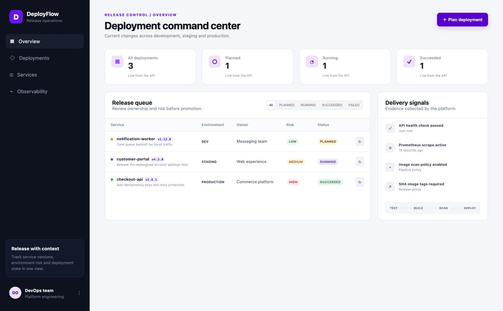

# DeployFlow

DeployFlow is a release operations dashboard for tracking service versions as they move through development, staging, and production. It replaces the reference TaskBoard domain with an original application and keeps the full capstone DevOps path: test, build, scan, publish, provision, deploy, and observe.



## What the application does

Release operators can create a deployment record, review its owner and risk, filter the release queue, and move a deployment through planned, running, and succeeded states. The React frontend calls a FastAPI REST API. PostgreSQL stores deployment records, and Alembic owns the database schema.

### API surface

| Method | Path | Purpose |
| --- | --- | --- |
| `GET` | `/health` | Liveness check |
| `GET` | `/ready` | Database-aware readiness check |
| `GET` | `/metrics` | Prometheus metrics |
| `GET` | `/api/deployments` | List deployment records |
| `GET` | `/api/deployments/{id}` | Read one deployment |
| `POST` | `/api/deployments` | Plan a deployment |
| `PUT` | `/api/deployments/{id}` | Update release state or metadata |
| `DELETE` | `/api/deployments/{id}` | Delete a deployment record |
| `GET` | `/api/deployments/stats` | Aggregate status counts |

Swagger UI is available at `http://localhost:8000/docs` when the stack is running.

## Architecture

```text
Developer push
    |
    v
GitHub Actions
    |-- pytest + Ruff
    |-- Vite production build
    |-- Docker image builds
    |-- Trivy HIGH/CRITICAL gate
    `-- GHCR images tagged with the Git SHA
                  |
                  v
          Terraform: VPC + EKS
                  |
                  v
            Helm deployment
         +--------+---------+
         |                  |
    React + Nginx       FastAPI (2 pods)
         |                  |
         +---- /api --------+
                            |
                        PostgreSQL
                            |
             Prometheus ServiceMonitor
                            |
                         Grafana
```

## Run locally with Docker Compose

Requirements: Docker Desktop or Docker Engine with Compose v2.

```bash
docker compose up --build -d
docker compose ps
```

Open:

- Application: `http://localhost:3000`
- API documentation: `http://localhost:8000/docs`
- Health: `http://localhost:8000/health`
- Metrics: `http://localhost:8000/metrics`

Stop the stack with `docker compose down`. Add `-v` only when you intentionally want to delete the local database volume.

## Test and check code quality

```bash
python3 -m venv .venv
source .venv/bin/activate
pip install -r backend/requirements.txt
cd backend
pytest -v
ruff check app tests
```

The suite contains nine tests across health, readiness, create, list, read, update, delete, validation, statistics, and metrics behavior. Tests override the application dependency with an isolated in-memory SQLite database; they never use the PostgreSQL instance from Compose or Kubernetes.

## CI/CD and security

`.github/workflows/ci-cd.yml` runs on every push and pull request to `main`.

1. Install Python dependencies, run `pytest -v`, and run Ruff.
2. Install frontend dependencies with `npm ci` and build the Vite bundle.
3. Build backend and frontend images.
4. Scan both images with SHA-pinned Trivy. HIGH or CRITICAL findings fail the job.
5. Push both images to GHCR using the immutable Git commit SHA.
6. Deploy the same SHA tags with Helm when `KUBE_CONFIG_DATA` is configured.

Required GitHub repository secrets for cluster deployment:

- `KUBE_CONFIG_DATA`: base64-encoded kubeconfig
- `POSTGRES_PASSWORD`: database password for the Helm release

Trivy scans the operating-system packages and application dependencies inside both images. A clean result means the scanner found no unfixed HIGH or CRITICAL vulnerabilities under the configured policy; it does not replace patching, dependency review, or runtime controls.

## Terraform on AWS

The Terraform configuration provisions a VPC spanning two availability zones, two public subnets, two private subnets, one NAT gateway, an EKS control plane, and a managed worker node group with two desired nodes.

```bash
cd terraform
cp terraform.tfvars.example terraform.tfvars
terraform init
terraform fmt -check -recursive
terraform validate
terraform plan -out=deployflow.tfplan
terraform apply deployflow.tfplan
aws eks update-kubeconfig --region ap-south-1 --name deployflow-eks
```

After evaluation, prevent ongoing EKS and NAT Gateway charges:

```bash
terraform destroy
```

Do not commit AWS access keys, kubeconfig files, state files, or real passwords. The repository ignores all Terraform state and plan artifacts.

The exact credential options, IAM capabilities, quotas, installed tool versions, and safe evidence sequence are documented in [`docs/AWS_ACCESS_REQUIREMENTS.md`](docs/AWS_ACCESS_REQUIREMENTS.md). After CI publishes the SHA-tagged images, `scripts/deploy-eks.sh` installs the NGINX ingress controller and DeployFlow release on the provisioned EKS cluster.

## Kubernetes and Helm

```bash
kubectl apply -f k8s/namespace.yaml
helm upgrade --install deployflow ./helm/deployflow \
  --namespace deployflow \
  --values helm/deployflow/values-prod.yaml \
  --set backend.image=ghcr.io/OWNER/deployflow-backend \
  --set frontend.image=ghcr.io/OWNER/deployflow-frontend \
  --set backend.tag=GIT_SHA \
  --set frontend.tag=GIT_SHA \
  --set-string postgres.password="$POSTGRES_PASSWORD" \
  --wait --timeout 10m
```

Verify:

```bash
kubectl get pods -n deployflow
kubectl get svc -n deployflow
kubectl get ingress -n deployflow
helm list -n deployflow
```

The default chart runs two backend replicas and two frontend replicas. Both application Services use `ClusterIP`; the Ingress sends `/api` to FastAPI and `/` to Nginx. Liveness and readiness probes protect rollout health. Container security contexts drop Linux capabilities and prevent privilege escalation.

## Prometheus and Grafana

Install the monitoring stack and the included dashboard:

```bash
helm repo add prometheus-community https://prometheus-community.github.io/helm-charts
helm upgrade --install kube-prometheus-stack prometheus-community/kube-prometheus-stack \
  --namespace monitoring --create-namespace \
  --values monitoring/prometheus-values.yaml
kubectl apply -f monitoring/deployflow-dashboard-configmap.yaml
```

The DeployFlow chart creates a `ServiceMonitor` that discovers both backend pods on `/metrics`. The Grafana dashboard includes request rate by endpoint and total requests during the last 15 minutes.

## Project structure

```text
backend/              FastAPI, SQLAlchemy, tests, and Alembic
frontend/             React, Vite, Nginx, and responsive CSS
.github/workflows/    CI/CD pipeline
terraform/            AWS VPC and EKS
helm/deployflow/      Deployments, Services, Ingress, HPA, and ServiceMonitor
k8s/                  Namespace bootstrap
monitoring/           Prometheus/Grafana values and dashboard
evidence/             Verified screenshots and command logs
docs/                 Submission checklist, AWS access guide, and presentation notes
troubleshooting/      Intentionally broken practice manifests
```

## Evidence

Verified screenshots live in [`evidence/screenshots`](evidence/screenshots), including the application, Compose services, Swagger API, Prometheus/Grafana, Terraform plan and destroy, the active AWS EKS console, Ready worker nodes, Running Helm workloads, ELB hostname, GitHub Actions success graph, SHA-tagged GHCR package, and the application served from EKS. The delivery workflow completed successfully at [GitHub Actions run #1](https://github.com/Shrivalkumar/Devops-Final-Project/actions/runs/38908686688); see [`docs/SUBMISSION_CHECKLIST.md`](docs/SUBMISSION_CHECKLIST.md).

## Live demonstration

For the final demo, change a visible label, commit it, and push to `main`. Show the test job, frontend build, two image scans, SHA-tagged GHCR packages, and Helm deployment. Refresh the application after rollout, then open Prometheus targets and the DeployFlow Grafana dashboard to show the same release under observation.
